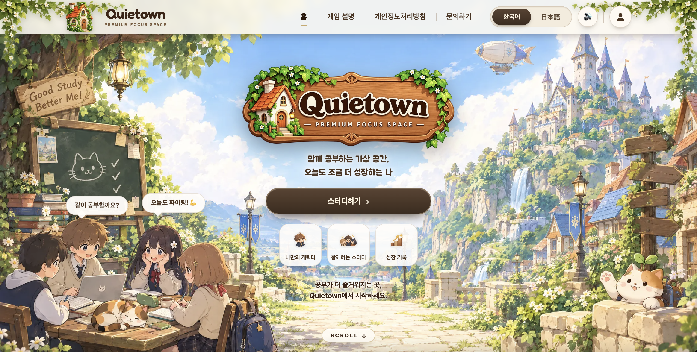
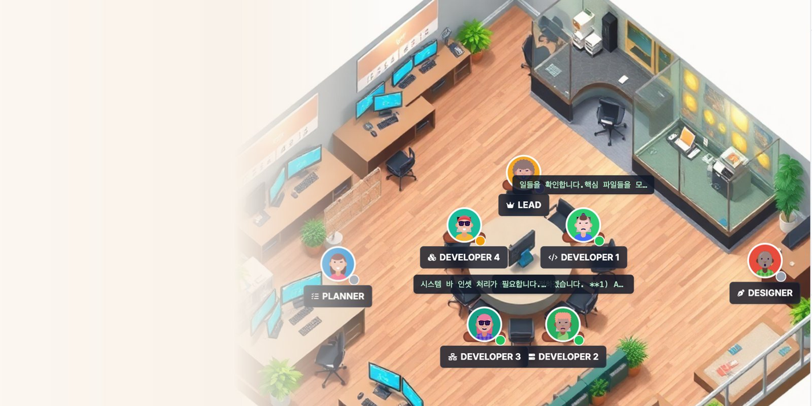
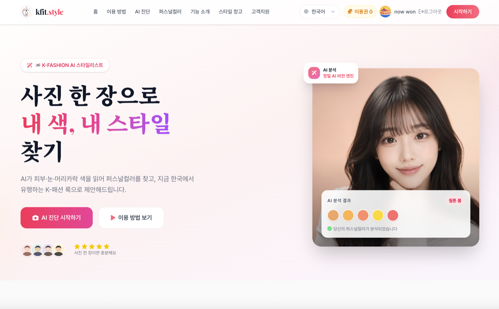

### 안녕하세요! 웹 + 모바일 풀스택 개발자 **노원상**입니다 👋

Android · iOS · Web · Server · Infra — 기획부터 배포·운영까지 풀사이클을 다루는 **7년 차** 개발자입니다. 
상용 모바일 솔루션을 대체할 자체 플랫폼을 구축했고, AI 도구를 실무에 깊게 적용해 1인이 팀 규모의 결과를 냅니다.

  

| 🧩 전 영역 풀스택 | 🏢 상용 솔루션 탈피 | 🌱 기술 리더십 | 🚀 1인 서비스 런칭 | 🏆 외부 검증 |
| :---: | :---: | :---: | :---: | :---: |
| **모바일 · 웹 · 서버 · AI** | **국내 1위 → 자체 플랫폼** | **회사 최초 RN 도입** | **서비스 3개 운영** | **국책과제 · 59:1** |
| 7년 차 · 앱 10+ · 웹 5+ · 서버 10+ 운영 | 앱 · 관리자 웹 · 푸시 서버를 2인 · 5개월 만에 구축 | 더존비즈온 · 사내 기술 교육 주도 | Quietown · kfit.style · AI 픽셀 오피스 | 과기정통부 · KISA 과제 성공 · NHN 해커톤 본선 |

 

<!-- 탭 네비게이션 -->

 

## 🚀 개인 프로젝트

<table>
<tr>
<td width="42%" align="center">

</td>
<td width="58%">

### 🏡 Quietown

**3D 멀티플레이 가상 스터디 공간** &nbsp; 

나만의 3D 아바타로 라운지·도서관·독서실 등 다양한 맵에 모여 함께 공부하고, 집중 타이머(25분 공부 · 5분 휴식)를 완료해 모은 코인으로 아바타를 꾸미는 웹 서비스입니다.

- 🙋 기획 · 디자인 · 개발 · 배포 · 운영 **1인 풀사이클** 수행
- 🌐 Durable Objects 기반 실시간 멀티플레이 · 채팅 · WebRTC 화상 대화
- 🧊 Three.js(R3F) 3D 맵 7종 · AI 3D 에셋 파이프라인(리깅 · 애니메이션) 구축
- 🪙 서버 권위 경제(코인 · XP · 레벨) · 🔐 Google · Kakao · GitHub 소셜 로그인
- ⚡ **웹 성능 개선 루프 자동화** — Claude in Chrome + Chrome DevTools로 Core Web Vitals(LCP · INP · CLS) 측정 → 원인별 개선(이미지 최적화 · 캐싱 · 코드 분할 / 불필요한 재렌더링 제거) → 재측정으로 효과를 수치 확인
- 📈 GA4 · Microsoft Clarity 사용자 행동 분석 · Sentry 에러 모니터링
- 🌏 한국어 · 일본어 다국어 지원

      

</td>
</tr>
<tr>
<td width="42%" align="center">

</td>
<td width="58%">

### 🏢 AI 픽셀 오피스

**여러 개의 앱을 동시에 유지보수 · 개선할 수 있는 AI 개발팀** &nbsp; 

앱 10개를 유지보수하며 정책 · 버전이 바뀔 때마다 앱을 하나씩 고치던 반복 작업을 없애려고 만들었습니다. 지시 한 줄이면 팀장 AI가 나누고, 개발자 AI들이 동시에 고치고, 팀장이 검토해 보고합니다.

- ⚡ 시연: 앱 4개 「SDK 36 · Xcode 27 업그레이드」 → **약 6분 · 파일 29개 수정 + 종합 보고서**
- ➕ 앱이 늘면 **개발자 에이전트 추가**(최대 12명) — 담당 앱 · 스킬만 주면 팀장이 바로 배정
- 📋 팀장 보고서가 앱 간 불일치 · 출시 블로커까지 발견, 애매한 결정은 AI가 멈추고 질문

     

</td>
</tr>
<tr>
<td width="42%" align="center">

</td>
<td width="58%">

### 🎨 kfit.style

**AI 퍼스널컬러 & K-스타일 진단 서비스** &nbsp; 

사진 한 장으로 AI가 퍼스널컬러를 진단하고, 얼굴은 그대로 유지한 채 K-패션 전신 코디 6가지를 생성하는 웹 서비스입니다.

- 🙋 기획 · 디자인 · 개발 · 배포 · 운영 **1인 풀사이클** 수행
- 🤖 OpenAI 이미지 생성 파이프라인 직접 설계 · 운영
- 🔐 Google OAuth 로그인 · 💳 Polar 결제 연동
- 📈 GA4 · Microsoft Clarity 사용자 행동 분석 · Sentry 에러 모니터링

     

</td>
</tr>
</table>

 

## 💼 경력 · 핵심 경험

| 회사 | 기간 | 역할 |
| :--- | :---: | :--- |
| 🏢 **동화기업(주)** | 2022.07 ~ 현재 | Web · Mobile 풀스택 Technical Lead — 사내 앱 10개+ · 웹 · 서버 · 인프라 사실상 단독 운영, 상용 솔루션 내재화 주도 |
| 🏢 **(주)더존비즈온** | 2019.07 ~ 2022.01 | 모바일 개발 — React Native 사내 최초 도입 · 크로스플랫폼 신규 앱 4종 개발 · Android B2B 앱 유지보수, 사내 기술 교육 주도 |

#### ⭐ 핵심 경험

- 🚀 **외부 모바일 솔루션(Morpheus)을 대체할 자체 풀스택 플랫폼 기반 구축 (핵심 2인 · 5개월)** 
  앱 공통 기반(React Native) · 관리자 웹(Vue 3) · 푸시 서버(Spring Boot) · AWS CI/CD를 직접 설계 · 구축 — 관리자 웹에서 OTA 배포 · 버전 · 디바이스 · 푸시를 직접 관리하고 푸시 · 앱스토어 통계 대시보드로 운영 상태를 확인, 이후 앱 · 서버 내재화의 기반 마련
  - 관리자 · 푸시 서버: Spring Boot 3.5 · JPA로 구축(관리자 API 110여 개) — iOS · Android 사내 배포 자동화, FCM HTTP v1 멀티캐스트 발송 · 무효 토큰 자동 정리

- 🖥️ **사내 웹 서비스 3종 프론트엔드 개발 (React · Vue 3 · Nuxt 3)**
  - 일렉 키오스크: 사내 부스 운영 키오스크 웹 개발 (18일, 현장 장애 0건 · 부스 참여자 전년 대비 5배)
  - 사내 앱스토어: 사내 앱을 배포하는 Enterprise 앱스토어 웹페이지 개발
  - 모바일 관리자 페이지: 사내 모바일 앱 관리자 플랫폼(Vue 3) 웹 개발

- 🙋 **개인 서비스로 AI 웹 서비스를 1인 풀사이클 운영 (React · Next.js · Three.js)**
  - 3D 메타버스 가상 스터디 웹(Quietown) 개발 · 운영
  - AI 퍼스널컬러 진단 웹(kfit.style) 개발 · 운영
  - 멀티 에이전트 AI 개발팀(AI 픽셀 오피스) 개발 — 사내 앱 유지보수에 활용

- 🎮 **NHN GAME × AI 해커톤 3D 웹 게임 2종 개발 (React · Three.js · Cloudflare Durable Objects)**
  - 3D 멀티플레이 추리 게임(Who is AI?) 개발 — 예선 59:1 본선 진출
  - 3D 물리 추리 게임(Who is Human) 개발 — 48시간 해커톤 본선작

- 🤖 **AI 업무 루프 자동화로 반복 업무 효율화** 
  AI가 결과를 확인하고 다시 고치는 루프를 직접 설계해 반복 업무를 자동화
  - [앱 내재화 · 리뉴얼 디자인 자동화](https://portfolio-website-7e1.pages.dev/automation#internalization-design): 디자인 규칙 → AI 시안 → 구현 → 구 · 신 앱 비교 루프로 GreenNet 전체 서비스 16종을 2주 만에 내재화
  - [웹 성능 개선 루프 자동화](https://portfolio-website-7e1.pages.dev/automation#web-performance): Chrome 자동화로 측정 → 원인별 개선 → 같은 조건 재측정 (인트로 LCP 7.75 → 2.05초)
  - [앱 유지보수 자동화](https://portfolio-website-7e1.pages.dev/automation#app-maintenance): AI 픽셀 오피스로 지시 한 줄에 여러 앱을 동시에 수정 · 점검

- 📱 **외부 솔루션에 묶인 앱 5종을 자체 기술로 내재화 (React Native · Expo)**
  - 스마트팩토리 앱(Smart-Factory) · 베트남 원재료 관리 앱(D-RMS VN): 자바스크립트 네이티브 브릿지를 설계해 WebView 안에서 푸시 · 로그인 · 업데이트 체크 같은 네이티브 기능을 쓰도록 내재화
  - 영업물류 앱(D-Sales): 주문 · 출고 · 배송 · A/S 78개 화면을 51일 만에 1인 재구축
  - 파트너사 영업물류 앱(D-Partners): 대리점 · 파트너사용 90여 화면을 React Native(New Architecture) · Expo로 1인 내재화 — Kotlin · Swift 네이티브 모듈(인앱 업데이트 · 파일 다운로드 · 미리보기)을 직접 만들고, 자체 OTA로 스토어 배포 없이 수정 반영
  - 사내 그룹웨어 앱(GreenNet): 전자결재 · 게시판 · 회의실 등 전체 서비스 16종을 2주 만에 내재화, 기존 동작을 유지해 사용자가 낯설지 않게 전환

- 🔁 **외부 솔루션 · 구버전 서버 5종을 Spring Boot로 내재화 (Spring Boot 3.5 · Java 21 · AWS)**
  - 게이트웨이 2종(공통 인증 · 영업물류): Morpheus → Spring Boot 3.5 · Java 21 전환, 영업물류 GW 285개 API 1인 전환, 앱 수정은 최소화
  - 사내 그룹웨어(GreenNet) 모바일 서버: 구형 Spring 서버를 Spring Boot 3.5로 전환 — API 62개를 원본과 차이 0으로 맞추고 테스트 126개로 출력까지 검증해 기존 앱 수정 없이 교체 (진행 중)
  - 모바일 관리자 서버 · 푸시 서버: 외부 솔루션 콘솔 · 푸시 대신 Spring Boot 3.5로 직접 구축 — 앱 배포 · 단말 관리와 푸시 발송 · 결과 추적을 사내에서 운영
  - 보안: 최신 LTS(Spring Boot 3.5 · Java 21)로 선제 업그레이드, 시크릿을 코드 밖 보안 저장소로 분리, 인증 · 권한 체계와 로그 민감정보 마스킹 적용

- 🌱 **더존비즈온 — 회사 최초 React Native 도입과 신규 앱 4종 개발 (React Native · TypeScript · Redux)**
  - 블록체인 간편계약 앱(WehagoOne): 과기정통부 · KISA 「2020 블록체인 민간주도 국민 프로젝트」 선정 과제 성공
  - 블록체인 DID 앱(우리도): 강원도청 플랫폼 — 음성/화상 통화 · 명함 촬영 구현 · 출시
  - 전자서명 인증 앱(WehagoSign): 회사 최초 React Native 프로젝트 1인 개발 · Redux-Observable 아키텍처 설계
  - 직원관리 앱(Nahago): 임금명세서 · 출퇴근 · 연말정산, 본인확인(PIN · Face ID · FIDO · NICE) · 전자서명 인증서
  - 사내 React Native · Redux · Kotlin 교육과 테크톡 주도

- 🛠️ **모바일 · 서버 단독 운영 체계 구축 (웹앱 · 하이브리드 앱 · 네이티브 앱 · Spring · AWS)** 
  사내 앱 10종+ 배포 · 정책 대응 · 기능 개선 100건+, AWS 인프라 운영과 DB 메이저 버전 무중단 업그레이드, 인증 · 시크릿 관리 · 로그 마스킹 등 보안 적용

- 📈 **모니터링으로 문제를 먼저 찾아 고치는 운영 (Crashlytics · Clarity · GA4 · Sentry · WhaTap · CloudWatch)**
  - 앱: Clarity 세션을 Crashlytics · GA4 오류에 연결해, 재현이 어려운 오류도 사용자가 겪은 화면 흐름 그대로 확인 (D-Sales · D-Partners)
  - 서버: WhaTap · CloudWatch로 CPU · Heap · 디스크를 정기 점검 · 튜닝해 리소스 부족 장애를 사전에 차단
  - 개인 서비스: GA4 · Clarity로 이탈 구간을 찾아 화면 개선(kfit.style), Sentry로 에러 추적(kfit.style · Quietown)

#### 🏆 수상 · 대외 활동
- **NHN 해커톤 NAN 2026 : Next AI Network — 59:1 경쟁률 본선 진출** · 예선작 「Who is AI?」로 본선 진출 → 본선작 「Who is Human」 48시간 개발 ([기사](https://www.todaymild.com/news/articleView.html?idxno=38410))
- 2018 한림대학교 SW 솔루션 공모전 금상 (팀)

 

## 🛠️ Tech Stack

> 상세 기술 스택과 프로젝트별 활용 내역은 [포트폴리오](https://portfolio-website-7e1.pages.dev/)에서 확인하실 수 있습니다.

#### 📱 Mobile

  
  
  
  
  
  
  
  
  
  
  
  
  
  
  
  
  
  

#### 🌐 Web Frontend

  
  
  
  
  
  
  
  
  
  
  
  
  
  

#### ⚙️ Backend

  
  
  
  
  
  
  
  
  
  
  
  
  
  

#### ☁️ Infra & DevOps

  
  
  
  
  
  
  
  
  
  
  
  
  

#### 🤖 AI

  
  
  
  
  
  
  
  

🎨 생성형 콘텐츠 — Midjourney · Kling AI · Sora · HeyGen · Higgsfield · Tripo · Meshy · Suno · ElevenLabs · Spline · uxPilot · Gamma · Genspark · NapKin · Rabbit

> 💡 **AI로 서비스를 만들어 운영합니다** — kfit.style(OpenAI 이미지 파이프라인) · Quietown(NVIDIA NIM AI 일정 플래너), Figma MCP + uxPilot 디자인 자동화로 디자인 기간 15일 → 2일

#### 🎨 Design

  
  
  

#### 🛡️ Security & Monitoring

  
  
  
  
  
  
  
  
  

#### 🎮 Game Engine (학습 중)

  
  

 

## 📊 GitHub Stats

  

 

